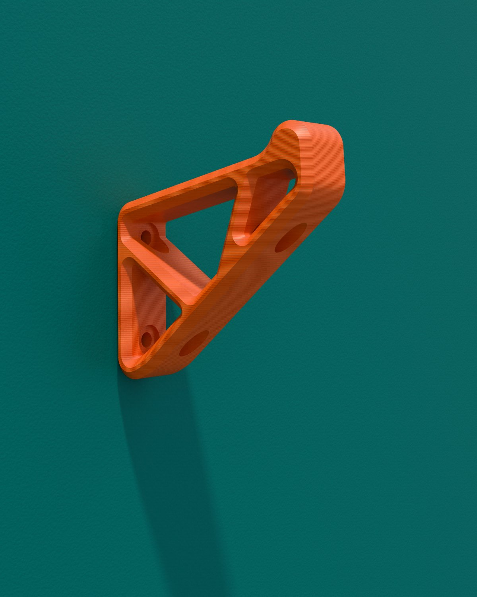
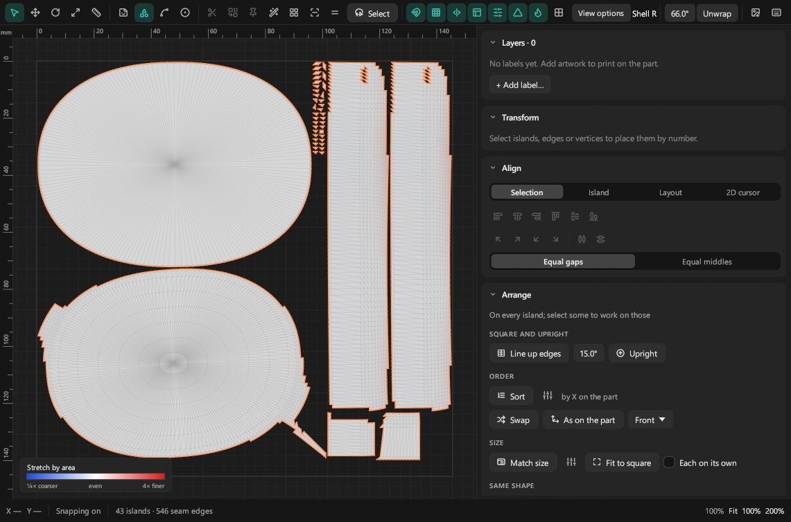

# Tequila: Product Rendering

**[Website](https://ifpintac.github.io/tequila/)** · **[Download](../../releases/latest)** · **[Discord](https://discord.gg/Na5T2qgQBX)** · **[Support on Ko-fi](https://ko-fi.com/ifpintac)**


**Free, open-source product rendering for Windows, Mac and Linux.** Bring in a CAD
model, put real materials on it, light it, and render pictures of the product
- with the viewport rendering the final image live as you work.

Tequila is built to the same workflow as commercial product renderers such as
KeyShot, written independently from published rendering science
([TRADEMARKS.md](TRADEMARKS.md)). It renders through **Cycles**, Blender's
production renderer (Apache-2.0), on the graphics card or the processor, and
has a path tracer of its own as well.

## Download

Get the newest version from the **[Releases page](../../releases/latest)**:

| | File | Needs |
|---|---|---|
| **Windows** | `Tequila-Setup-<version>.exe` | Windows 10 or 11, 64-bit. An NVIDIA graphics card (GTX 900 series or newer) or an AMD one (RDNA, Radeon RX 5000 series or newer) renders on the graphics card, every card at once when there are several; any other computer renders on the processor. |
| **Windows, portable** | `Tequila-Portable-<version>-windows.zip` | The same, with nothing to install, in the releases after 2026.11.06.0224. Extract it anywhere you can write to (a USB drive, your Documents; not Program Files) and open `Tequila.exe`. |
| **Mac** | `Tequila-<version>.dmg` | A Mac with Apple's own chips (M1 or newer) and a recent macOS. |
| **Intel Mac** | `Tequila-<version>-intel.dmg` | A Mac with an Intel processor and macOS 12 or newer. Renders with Tequila's own renderer: Cycles comes from Blender, whose current version no longer runs on Intel Macs. |
| **Linux** | `Tequila-<version>-linux-x86_64.tar.gz` | 64-bit Linux with glibc 2.35 or newer (Ubuntu 22.04, Debian 12, Fedora 36 or later). Unpack it anywhere and run `./Tequila`; `./install.sh` adds it to the application menu. An NVIDIA or AMD graphics card renders with Cycles, as on Windows. |

To update, choose **Help > Check for updates**: Tequila fetches the newer
version from this page, checks it against the SHA-256 GitHub lists for it,
and installs it (on a Mac it opens the disk image, for Tequila to be dragged
into Applications). It also looks once a day when it starts, which the same
window can turn off. Or download the newer one and install it over the old.
Either way your materials, plugins and settings are kept. Plugins are written in Python, so
they need Python 3 on the computer (on a Mac, it comes with Apple's command
line tools).

**The portable version** keeps everything it remembers - settings, library
materials, plugins, studio presets, recent projects, caches, crash reports
and the journal - in a `data` folder beside `Tequila.exe` instead of the
computer's user folders: that is what the `portable.txt` beside it does, and
**Help > About Tequila** says so. Renders and projects go where you save
them. **Help > Check for updates** downloads the newer zip into the folder
rather than running an installer; close Tequila and extract it over the same
folder, and the `data` folder, which is not in the zip, stays. Don't run the
installer over a portable copy: it would install a second Tequila.

**The first time you open it**, your computer warns you, because Tequila is
not signed with a paid certificate:

- **Windows** shows "Windows protected your PC": click **More info**, then
  **Run anyway**. Signing for Windows, free through the SignPath
  Foundation, is being set up: see the [code signing policy](docs/CODE-SIGNING.md).
- **Mac** says Apple could not verify it: click **Done**, open **System
  Settings > Privacy & Security**, scroll down and click **Open Anyway** next
  to Tequila.

## Community and support

Questions, bugs, ideas and renders: join the
**[Tequila Discord](https://discord.gg/Na5T2qgQBX)**. Bugs can also go in
[GitHub issues](../../issues).

Tequila is free, with no account, no licence key and no ads. If it saves you
time, you can support it on **[Ko-fi](https://ko-fi.com/ifpintac)**.

## Testing Tequila on your computer

Tequila is made on a Windows PC with one NVIDIA card, and tested on GitHub's
Windows and Mac machines. If yours is something else - an AMD graphics card,
several cards, an Intel or Apple-silicon Mac, Linux - you can help:

1. Choose **Help > Test this computer** and wait a minute or two (longer
   the first time a graphics card is used, while it prepares). It renders a
   small scene with every engine and graphics card it finds, times each and
   checks the picture against a reference, then tries the denoisers and the
   viewport.
2. Click **Copy the report** and paste it into the
   [Tequila Discord](https://discord.gg/Na5T2qgQBX).

Tequila sends nothing anywhere itself, and the report names no one: no user
or computer name, no file paths, serial numbers or network addresses - just
the system, processor, memory, graphics cards and drivers, and how each check
went. The report and the pictures are also kept in `.tequila/self-test` in
your home folder (`data\self-test` in a portable copy). From a terminal it is `tequila-cli --self-test` (beside
Tequila once installed; `Tequila.app/Contents/MacOS/tequila-cli` on a Mac),
with `--cpu-only` to leave the graphics cards out.

## What it does

<p>
  
  
  
</p>

- **Import CAD and 3D models** - STEP (through OpenCASCADE), IGES, Rhino
  (`.3dm`, with its layers, materials and blocks), Blender (`.blend`, read
  by your Blender, its materials node for node, and its lights if you
  choose), glTF/GLB, FBX,
  OBJ (with ZBrush polypaint), STL, 3MF, PLY, USD and IFC, with assemblies,
  names, colours and units, and a CAD file's attributes and layers (shown and
  hidden as groups); very large models; re-tessellate and re-import that
  keep your work. Send models from Blender (live), SolidWorks and ZBrush
  ([integrations](integrations)). Open KeyShot scenes (`.ksp`, `.bip`) with
  their materials, lighting and cameras ([notes](docs/keyshot-import.md)).
- **Materials** - a library of 309 procedural materials (plastics, metals,
  glass, paints with flakes, fabrics with real fibres, gems, liquids with
  bubbles, wood, stone...), a node editor, labels and decals, texture packs, KeyShot
  material packages (.kmp), Adobe Substance materials (.sbsar) with their
  settings (maps rendered by Adobe's sbsrender when installed), colourways and
  variants. Drop a material on a part, on a selection or on a whole group.
- **UV editor and labels** - unwrap a part in a click; cut and stitch seams,
  pin, pack, straighten and relax islands; symmetry, a 2D cursor, snapping,
  rulers, guides and layers; labels placed and sized in millimetres; texel
  density and a stretch heatmap, and SVG or PNG layout export.
- **Lighting** - HDRI environments and an HDRI editor, sun and sky, area,
  spot, point and IES lights, light groups you can relight after rendering,
  and studio presets that set up lights, cameras, floor and look for any
  product in one step.
- **Camera and look** - a photographic camera with depth of field,
  orthographic views, and AgX, ACES and PBR Neutral tone mapping.
- **Floors** - shadow catchers, contact shadows, and objects-only mirror
  reflections.
- **Rendering** - Cycles on NVIDIA and AMD cards (every card at once) or the
  processor, and Tequila's own path tracer with spectral rendering for gems;
  a queue, render layers and passes (Cryptomatte included), region renders,
  EXR/PNG/JPEG, batch renders of every configuration, turntables, network
  rendering across computers, and **Render wireframe** for line drawings in
  a second or two.
- **Sharing** - web export (live 3D or pre-rendered:
  [try one](https://ifpintac.github.io/tequila/demo/helmet-holder/)), a spin
  viewer, glTF and USD export, and USDZ to stand the product in a room at
  its real size on an iPhone, iPad or Vision Pro; a full-screen
  presentation mode.
- **Cutaways**, measurements, model sets and a configurator.
- **AI apps and automation** - connect Claude, Cursor, VS Code (GitHub
  Copilot), Codex, Gemini CLI, Windsurf or LM Studio in one click, or any
  other MCP app, and let it set up materials, lighting and renders, make
  materials from a description, or write plugins; a built-in Assistant for
  OpenAI, Claude, Gemini, OpenRouter, Mistral, DeepSeek, xAI, Groq or a local
  model;
  Python scripting, plugins, a command-line renderer, and a Blender live link.

Beyond turntables, animation is not part of Tequila yet; it's on the
[roadmap](https://ifpintac.github.io/tequila/roadmap.html).

## Building it yourself

Tequila is written in Rust. You need the Rust toolchain and two prebuilt SDKs
(Intel Embree and Open Image Denoise, both Apache-2.0), which a script
fetches into `third_party/`:

```bash
# Windows
pwsh scripts/fetch-third-party.ps1
# macOS and Linux
bash scripts/fetch-third-party.sh

cargo run --release -p tequila-app
```

That runs Tequila with its own renderer. Cycles and the OpenCASCADE STEP
reader are built separately: `native/cycles/build-cycles.ps1` (Windows) or
`build-cycles.sh` (Mac), and `native/occt/build-occt.bat` or `build-occt.sh`.
The installers come from `scripts/package-windows.ps1` with
`scripts/package-installer.ps1`, and `scripts/package-macos.sh`.
[`docs/MACOS_PORT.md`](docs/MACOS_PORT.md) covers the Mac.

The tests run in release mode - the rendering tests integrate hundreds of
thousands of samples each:

```bash
cargo test --workspace --release
```

## Documentation

- [The website's docs](https://ifpintac.github.io/tequila/docs.html), and
  [what's new](https://ifpintac.github.io/tequila/whats-new.html) in each version
- [Scripting and AI apps](docs/SCRIPTING.md) - Python, the command line, and
  MCP for AI apps
- [Writing plugins](docs/plugins.md)
- [Making materials](docs/materials-authoring.md)
- [The specification](docs/TEQUILA_SPEC.md), the engineering [roadmap and status](docs/05-ROADMAP-AND-TESTING.md), and the [public roadmap](https://ifpintac.github.io/tequila/roadmap.html)
- [Code signing policy](docs/CODE-SIGNING.md)

## Licence

Apache-2.0: see [LICENSE](LICENSE), [NOTICE](NOTICE) and
[THIRD_PARTY_LICENSES.md](THIRD_PARTY_LICENSES.md). Tequila the software has
nothing to do with tequila the drink ([TRADEMARKS.md](TRADEMARKS.md)).
